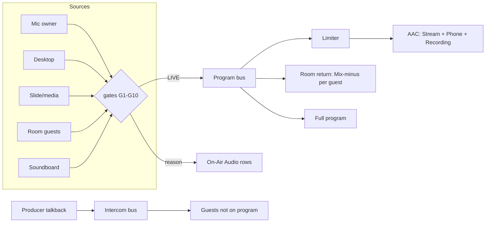

# ProShow On-Air Audio: plan

Status: plan only (Oct 18, 2026). No code changes yet. Branch `feat/float-clear-ppt-import-news-templates`, on top of ac18e21.

Kaleel's ask, short: the operator can't tell which audio is actually on air. Layers 1-6 show that an audio device was *added*, not whether it is *heard*. The Audio tab is a mixer, not a "what is on air" view. Build an **On-Air Audio** group between **Active on-air** and **Live sources** that shows:

1. which audio devices are streaming,
2. the program mix stack (what is summed now, including room guests),
3. per-source and per-layer control (mute, solo, listen, isolate),
4. return feeds (full program, mix-minus, intercom) and who hears what,
5. enough control for TV-level production.

---

## 1. Why "device added but silent" happens (root causes from the code)

A source reaches the stream only when **every** gate below passes. The UI shows none of them in one place today.

| # | Gate | Where | What the operator sees today |
|---|------|-------|------------------------------|
| G1 | **Shot is live, not just added.** The mic gate opens only when a Live sources layer's *live* shot (`liveShotID`) is a `.systemMicrophone` and `audioMuted != true`. A Microphone shot that sits in a layer's shot list but is not live = silent. | `ProgramAudioGatePolicy.derive` (AudioMatrixReconciler.swift) | The layer row lists the shot; there is no "live/armed" audio state. |
| G2 | **Cameras never carry the mic** (privacy rule plus the bcf4219 fix for doubled audio). A slide whose only "audio device" is a camera or a camera canvas object is silent. | `ProgramAudioGatePolicy`, `VideoIngestEngine.shouldAddCameraMicrophone == false` | The camera shows a speaker icon state, which reads as "has audio". |
| G3 | **Channel solo silences everything else.** `AudioMatrixEngine.outputLevel` returns 0 for every non-soloed channel when any channel is soloed. **The Stellar14-DemoDay project has Mic `solo = true` (and `muted = true`).** So Desktop, Slide, Soundboard and every guest channel stream at gain 0, and the muted mic is silent too. `enqueueCapture` then drops the PCM (`stream <= 0.0001`). This alone explains "some slides don't stream audio". | AudioMatrixEngine.swift `outputLevel`, RTMPStreamTransport.swift `enqueueCapture` | Solo is only visible in the Audio tab. Worse, the master meter adds `ProgramSlideAudioMeter` without the solo check (`processFrame`), so **the meter moves while the stream is silent**. |
| G4 | **Channel mute / program mute.** Per-channel `muted`, `programMuted`, `master.muted`. | AudioMatrixEngine | Audio tab only. |
| G5 | **Slide/media audio conditions.** Slide audio counts only when the slide is live, the program clock runs, the Slide layer isn't cleared, audience output is on and not cleared, the Slide/Media layer audio isn't muted, the media item isn't muted, the placeholder isn't muted, and no muted live shot feeds the same file/placeholder. | `ShowController.isProgramMediaMuted` | Spread across the slide inspector, layer mute and placeholder mute. |
| G6 | **One owner per role.** Since bcf4219/3c9b1f3, only one mic source owns the Mic role; a second mic is rejected until the first is silent for 0.3 s. Same for desktop. | `CaptureAudioSources.admit` | Only `/v1/audio/pipeline` (`rejectedFramesPerSecond`) shows it. |
| G7 | **Mic owns the mix over desktop.** Screen-share audio is held out (flushed) while the mic delivered PCM in the last 0.35 s (`microphoneOwnsMixWindow`). A slide with a screen share and a live mic loses the screen audio. | `ProgramStreamAudioGates.enqueueCapture` | Invisible. |
| G8 | **Some "carries audio" sources have no audio path.** `liveShotSourceCarriesAudio` returns true for NDI, SRT, mediaFile and libraryShow shots (the speaker button is enabled), but there is no `enqueueCapture` caller for NDI/SRT audio. **Suspected; confirm in Phase 0.** | ShowController `liveShotSourceCarriesAudio`; VideoIngestEngine | A speaker icon that does nothing. |
| G9 | **Room guests.** A guest is summed while their LiveKit audio sink isn't `suppressed` (desk mute) and their guest channel's stream gain > 0. **G3 applies: any solo silences guests.** | `GuestAudioSink`, `GuestProgramMixBus`, `ProgramStreamAudioGates.sync` | Guest level is visible in Backstage, but not whether the guest is in the program. |
| G10 | **No signal.** The device is open but delivers nothing (wrong input, permission, unplugged iPhone, Continuity drop). | capture lanes | Nothing. |

**How the UI exposes it:** each source row gets one state plus a one-line **reason** naming the first failing gate, in this order:
`Not live (shot added, not taken)` > `Picture only (camera has no audio)` > `Silenced by solo on <channel>` > `Muted (layer | channel | program)` > `Slide audio off: <condition>` > `Second mic: <owner> owns the mic` > `Held: mic owns the mix` > `No audio path for NDI/SRT` > `No signal for 10 s`.

Computing these needs a single **AudioRouteResolver** (pure function, section 4) shared by UI, API and tests. That keeps the explanation from drifting from the real gates.

---

## 2. The On-Air Audio group (sidebar)

Placement: in `LayersActionPane` (RightInspectorView.swift), between `ActionStackInspectorView` ("Active on-air") and `masterSection` ("Live sources"). It uses the same card style and the same `DisclosureGroup` with `@AppStorage("proshow.inspector.onAirAudioExpanded")`, expanded by default while live.

```
┌ Active on-air ─────────────────────────────┐
│ ...existing...                             │
└────────────────────────────────────────────┘
┌ On-Air Audio            ● 3 on air  ⚠ 1   ⋯┐
│ PGM  ▮▮▮▮▮▮▯▯ -14 LUFS  peak -3.1  ⓘ       │  ← program meter (LUFS-S, true peak, clip LED)
│────────────────────────────────────────────│
│ ON AIR                                     │
│ 🎙 MacBook Mic     L2  ▮▮▮▯▯  M S 🎧  LIVE │
│ 🎬 Slide audio     S3  ▮▯▯▯▯  M S 🎧  LIVE │
│ 👤 Ama (room)      G   ▮▮▯▯▯  M S 🎧  LIVE │
│ NOT HEARD                                  │
│ 🎙 Kaleel's Mic    L4  ▯▯▯▯▯  M S 🎧  ARMED│
│    Second mic: MacBook Mic owns the mic    │  ← reason line
│ 🖥 Screen share    L1  ▮▮▯▯▯  M S 🎧  HELD │
│    Held: mic owns the mix                  │
│ 📷 MacBook Camera  L1  —      picture only │  ← collapsed, dimmed
│────────────────────────────────────────────│
│ Returns  Room: Mix−  Intercom: off  ▸      │  ← return bus summary (Phase 3)
└────────────────────────────────────────────┘
```

Row fields: icon by **type** (mic, camera, room guest, media, slide, desktop/screen, NDI/SRT, soundboard). **Name.** **Origin** (`L2` = Live sources layer 2, `S3` = slide 3 object, `G` = room, `SB` = soundboard). **Peak meter** (post-gate, the level actually summed). **State** chip:

- `LIVE`: summed into program now.
- `ARMED`: would be heard, but blocked by an ownership/hold rule, or no audio yet.
- `MUTED`: by layer, channel or program (the reason says which).
- `NOT ROUTED`: no audio path, picture only, or not live.
- `NO SIGNAL`: open, but nothing above -70 dBFS for 10 s.
- `SOLO-OFF`: silenced by another channel's solo.

Header: count on air, a warning count (anything soloed, doubled source, clipping, silence while live), and a menu: *Clear all solos*, *Unmute all program sources*, *Open Audio tab*, *Copy diagnostics*.

Clicking a row selects the matching Live sources layer, slide object or guest, so the operator can fix it in place.

### Program mix stack view

The **ON AIR** section *is* the mix stack: every row in it is summed right now. When two or more are on air, a thin bracket on the left shows "Σ 3 sources". Room guests appear as rows (one per guest) with their LiveKit level and a `🔇 by desk` reason when desk-muted. Pop-out (⋯ > *Mix stack*) opens a wider sheet with a per-source meter, gain applied, bus, and contribution to the master (dB).



---

## 3. Controls

Per source row (Phase 2):

- **M** mute. Writes the true owner: the live shot's `audioMuted` for layer sources, the channel `muted` for slide/soundboard/desktop, and the LiveKit desk mute for guests. One click, and the reason line updates.
- **S** solo **for the stream is NOT what operators expect on air.** Today's channel solo silences the broadcast. Change: rename the existing behaviour *Isolate* (stream-affecting, red, confirm while live). Add **PFL/AFL listen (🎧)** that only changes the operator headphones (monitor bus). The program never changes.
- **Gain/fader.** Click-drag on the meter, or a popover with a ±dB fader and trim; it writes the channel `gainDb`, or the per-guest channel.
- **Follow mode** (per layer source): `Follow slide` (default for slide/media audio: heard only while its slide is live) vs `Always on` (house mic, room): stays in the mix across slide changes. Stored on `LayerShot`.
- **Delay (lip-sync)**: 0-500 ms per source (Phase 4).

Per layer (Live sources rows): show the same state chip next to the existing speaker button. The disabled speaker on a camera becomes "picture only".

Global: *Clear solos*, *Program mute* (exists), *Panic: mute all but host mic*.

---

## 4. Data model changes

- `AudioSourceDescriptor` (new, value type, not persisted): `id`, `name`, `type`, `origin` (`.layer(index, shotID) | .slideObject(slideID, objectID) | .guest(id) | .soundboard | .desktop`), `role: AudioChannelRole`, `state`, `reason`, `peakDb`, `gainDb`, `muteOwner`.
- `AudioRouteResolver.resolve(controller) -> [AudioSourceDescriptor]` (new, `@MainActor`, pure over `masterLayers`, `compositor.stack`, `audioMatrix`, `ProgramStreamAudioGates` snapshot, `CaptureAudioSources` snapshot, guest list). This is the single source of truth for UI, API and tests.
- `LayerShot.audioFollow: AudioFollow?` (`.followSlide | .alwaysOn`); optional, so old projects decode unchanged.
- `AudioMatrixChannel.listen: Bool` (PFL, not persisted); `isolate` = today's `solo` (persisted field name stays `solo` for compatibility; UI label changes).
- `AudioMatrixChannel.delayMs: Double?` (Phase 4).
- Return buses (Phase 3): `ReturnBus { id, kind: .programFull | .mixMinus(guestID) | .intercom, sends: [sourceID: Bool] }` in `BackstageRoomConfiguration` (already has `mixMinusEnabled`, `intercomEnabled`).

---

## 5. Audio engine changes

Phase 1 adds **read-only taps only**:

- Per-source post-gate peak: record in `ProgramStreamAudioGates.enqueueCapture` after gain (role-level today; add a source key next to the role). Use a lock-free `[String: Float]` peak table read at 15 Hz by the UI. No change to samples.
- Per-guest peak post-gain from `GuestProgramMixBus.mix`.
- Program bus: K-weighted short-term LUFS (3 s) and momentary (400 ms), and true-peak (4x oversample) on the mixed stereo frame in `deliverMixedProgramAudio`. This runs on the encode queue, about 1024 frames per 21 ms (cheap).
- Fix the misleading meter: `processFrame` must apply the same solo/mute rules to `ProgramSlideAudioMeter`.

Later phases:

- **Listen (PFL)**: monitor-bus-only gain override in `ProgramStreamAudioGates.sync` (`monitorGain`), leaving `streamGain` untouched.
- **Real master limiter**: today `AudioDSP.applyLimiter` clamps the master *gain scalar* and samples hard-clip at ±1. Add a look-ahead (5 ms) sample limiter and optional compressor on the program bus before AAC.
- **Ducking** exists (`duckingEnabled`, mic over others); expose it in the group.
- **Per-source delay** ring per role.
- **Per-guest mix-minus**: today the room gets one shared return = program minus *all* guests (`roomScratch`), and guests hear each other directly in LiveKit. For true mix-minus: either keep that model and label it honestly ("Program without guests + guests direct"), or publish one track per guest (program minus that guest) from `ProgramAppAudioFeeder`. That costs N extra Opus encodes; decide in Phase 3.
- **Intercom/talkback**: `backstage.intercomActive` and `returnFeedMode` exist in UI but are not wired to audio. Add a talkback source (producer mic, push-to-talk) published as a separate LiveKit track `proshow-intercom`, never summed into program. Guests on program get program return plus optional IFB; guests off program get intercom.

---

## 6. Return feeds and routing matrix

ProShow (Backstage panel and the On-Air Audio *Returns* row):

```
            │ Program │ Room return │ Intercom │ Recording │ Phone
────────────┼─────────┼─────────────┼──────────┼───────────┼──────
Host mic    │   ●     │     ●       │    ○     │    ●      │  ●
Slide audio │   ●     │     ●       │          │    ●      │  ●
Guest Ama   │   ●     │  − (minus)  │          │    ●      │  ●
Talkback    │         │             │    ●     │           │
```

● = sends, ○ = optional, − = mix-minus exclusion. Phase 3 is read-only with fixed rules (program, recording and phone all share the program bus today). Editable sends come in Phase 4.

Join page (foundry/showroom `GuestJoinApp.tsx`): today it attaches every remote audio track and has one "Mute program" button; the tally (`lib/tally.ts`) already knows live / on deck / idle.

- Label the return: "You hear: Program (without you)" or "Intercom".
- Separate volume for Program and Intercom.
- When tally is `idle`/`ondeck`, the producer can talk to the guest on Intercom without it reaching the stream.
- An "On air" banner plus a red mic ring when the guest's audio is in the program (driven by a new data packet `{audioOnAir: [identity]}` alongside the tally).

---

## 7. TV-level extras (backlog, ordered)

1. **Alerts**: silence on program while live for more than 5 s; clipping (true peak > -1 dBTP); doubled source (two sources of one role delivering, from `CaptureAudioSources`); solo/isolate active while live; mic muted while host is on camera. Show them as the header warning plus a toast.
2. **Master limiter/compressor** with a target of -14 LUFS (YouTube/X) and a -1 dBTP ceiling.
3. **Lip-sync delay** per source (camera vs USB mic).
4. **Headphone monitoring output** device picker; PFL/AFL; "monitor = program" lock.
5. **Keyboard shortcuts**: `⌥1..6` mute a layer's audio, `⌥M` host mic, `⌥⇧S` clear solos, hold `T` for talkback.
6. **Control API**:
   - `GET /v1/audio/onair` (resolver output: sources, states, reasons, peaks, LUFS),
   - `POST /v1/audio/source/{id}/mute|listen|gain`,
   - `POST /v1/audio/solo/clear`,
   - `GET /v1/audio/returns`.
   This extends today's `GET /v1/audio/pipeline` and `/v1/audio/meters`.
7. **Pre-flight**: an "Audio check" in PreFlightEngine that runs the resolver and lists blockers before Go Live (e.g. "Mic is soloed: other sources are silent").

---

## 8. Phased rollout

| Phase | Scope | Risk | Before church? |
|-------|-------|------|----------------|
| **0. Confirm** (0.5 day) | Reproduce each gate G1-G10 on localhost and confirm G8 (NDI/SRT audio). Add unit tests for `ProgramAudioGatePolicy` plus the solo rule. | none | yes |
| **1. Visibility only** (2-3 days) | `AudioRouteResolver`, On-Air Audio group (rows, state, reason, meters), program LUFS/true-peak meter, fix the slide-meter-ignores-solo bug, `GET /v1/audio/onair`, pre-flight solo warning, alert badges. **No change to what is summed.** | Low: read-only taps on the audio thread (lock-free peaks) | **yes, this is the only phase to ship before a church stream** |
| **2. Controls** (3-4 days) | Row mute/gain writing the true owner, rename solo to *Isolate* with confirm-while-live, add PFL listen (monitor only), follow-slide vs always-on, clear-solos, shortcuts. | Medium: writes to the matrix/gates; must keep single-owner rules | after a full soak |
| **3. Return feeds** (4-6 days, two repos) | Honest return labels, wire intercom (talkback track), join-page Program/Intercom volumes and an on-air banner, routing matrix read-only. Decide per-guest mix-minus. | Medium-high: LiveKit publish, Opus encode count | no |
| **4. TV extras** | Sample limiter/compressor, LUFS target, per-source delay, editable sends, headphone device. | Medium | no |

## 9. Risks to the just-stabilized pipeline (271ea77, ac18e21, bcf4219, 3c9b1f3)

- **Real-time threads.** Meters must not take the `ProgramStreamAudioGates.lock` longer, allocate, or dispatch to the main actor per buffer. Use atomics or a small fixed table, and read from the UI at 15 Hz.
- **Single-owner mic rule.** Controls must not reopen a second mic or a camera mic (bcf4219). The resolver *reports* G6; it never bypasses it.
- **Encode cadence.** LUFS/true-peak run on the AAC encode queue; budget under 0.2 ms per 21 ms AU. Measure with the night soak tooling. Keep the contiguous-PTS and catch-up pump (271ea77) untouched.
- **Project compatibility.** New fields are optional; `solo` keeps its JSON name.
- **Behaviour change on solo.** Turning today's stream-solo into Isolate plus a new PFL changes muscle memory. Ship the warning first (Phase 1), the behaviour change in Phase 2.
- **Room audio.** Per-guest mix-minus multiplies encode cost and LiveKit tracks. Keep the current shared return until measured.

## 10. Testing (localhost only, never real destinations)

- **Unit:** `AudioRouteResolver` table tests, one per gate G1-G10 (inputs: layers, stack, matrix, gate snapshot), including "Mic soloed and muted: slide = SOLO-OFF".
- **Integration (each phase):** the `~/snap/night` tooling. Run `stream_local_test` to `rtmp://127.0.0.1:19351/live/stream` and `19352/live/phone` with ffmpeg listeners, and `pk.py` for gaps, PTS and A/V. Compare `/v1/audio/onair` states with what the capture actually contains (RMS per segment): a source marked LIVE must be audible in the FLV; NOT ROUTED/SOLO-OFF must not be.
- **Regression:** 5x stream restart cycles, record-first and record-during-stream, plus a 60 min soak (camera + mic + slide changes + props + timer). Pass criteria are the Oct 18 numbers: 0 video gaps, a single 0.1 s audio blip at start only, A/V within 0.05 s, CPU within +5% of 59%, RSS flat after warm-up.
- **Room (Phase 3):** local showroom (`just dev showroom`, `http://127.0.0.1:3461/j/demo`) with a test guest. Verify mix-minus (guest doesn't hear self), intercom never in the FLV capture, and the on-air banner follows the tally.
- Never arm or stream to real X/YouTube/other destinations during any of this.
